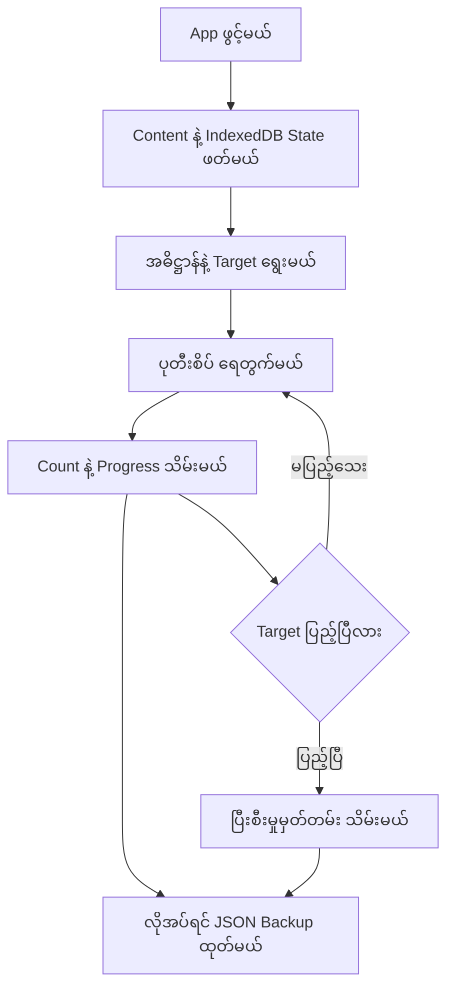

<p align="center"></p>

# Adhihtan (အဓိဋ္ဌာန်)

နေ့စဉ် အဓိဋ္ဌာန်အစီအစဉ် ရွေးချယ်ပြီး ပုတီးစိပ်အရေအတွက်နဲ့ ပြီးစီးမှုမှတ်တမ်းတွေကို သိမ်းထားနိုင်တဲ့ .NET 10 Blazor WebAssembly Project ပါ။ [App ကို ဒီမှာ ဖွင့်နိုင်ပါတယ်](https://adhihtan.vercel.app/)။

[Burma Project Ideas](https://github.com/burma-project-ideas) အောက်မှာ နောက်လာမယ့်သူတွေ လေ့လာနိုင်ဖို့၊ ကိုယ်နှစ်သက်တဲ့ Programming Language နဲ့ ပြန်ရေးကြည့်နိုင်ဖို့ ထားပေးထားတာပါ။ App က Browser ထဲမှာပဲ အလုပ်လုပ်ပြီး Account၊ Server Database နဲ့ Device တွေကြား Sync လုပ်တဲ့စနစ် မလိုအပ်ပါဘူး။

## အဓိက ပံ့ပိုးသူများနှင့် မူရင်း Data

| ပံ့ပိုးသူ / ရင်းမြစ် | ပံ့ပိုးထားသည့်အပိုင်း |
| --- | --- |
| [Sann Lynn Htun (@sannlynnhtun-coding)](https://github.com/sannlynnhtun-coding) | Git History အရ ပံ့ပိုးသူ၊ Blazor App နဲ့ UI ရေးသားမှု |
| Android App `com.a_dhi_htan`၊ Version `1.3.1` | ပြန်လည်ထုတ်ယူထားတဲ့ အဓိဋ္ဌာန်အကြောင်းအရာနဲ့ အစီအစဉ်များ |
| [Board UI](https://www.boardui.com/) | Floating Sidebar၊ Dashboard Panel၊ Button နဲ့ Settings Layout တို့အတွက် Design Reference |
| Rabbit Conversion Rules (`rabbit-node` 1.0.4) | Unicode/Zawgyi ပြောင်းလဲဖော်ပြတဲ့ Generated Converter ရဲ့ Rules |

မူရင်း Android App ရဲ့ Author နဲ့ Data ပြန်လည်ဖြန့်ဝေခွင့်ကို Recovered Metadata ထဲမှာ မဖော်ပြထားပါဘူး။ Image/Audio တွေရဲ့ Ownership အချက်အလက်လည်း မပြည့်စုံသေးပါဘူး။ ပြန်သုံးမယ်ဆိုရင် [Source Notices](THIRD_PARTY_NOTICES.md) ကို ဖတ်ပြီး သက်ဆိုင်ရာခွင့်ပြုချက်တွေကို စစ်ဆေးပါ။ Organization ဆီ ပြောင်းရွှေ့ထားတာက မူရင်းပံ့ပိုးသူတွေရဲ့ Credit ကို အစားထိုးတာ မဟုတ်ပါဘူး။

## အသုံးပြုပုံ

1. **စတင် (`/setup`)** မှာ အဓိဋ္ဌာန်အမျိုးအစား၊ အဆင့်၊ ဂုဏ်တော်နဲ့ တစ်ပတ်လျှင် ရေတွက်မယ့်အရေအတွက် ရွေးပါ။ စိတ်ကြိုက်အစီအစဉ်မှာ ပတ်အရေအတွက်နဲ့ တစ်ပတ်လျှင် ထိချက်ကို `1–108` အတွင်း ထည့်နိုင်ပါတယ်။
2. **ပုတီး (`/counter`)** မှာ ထိနှိပ်ပြီး ရေတွက်ပါ။ **နောက်ပြန်** က တစ်ချက်လျှော့ပေးပြီး **ပြန်စ** က ယနေ့ရေတွက်မှုကို သုညပြန်ထားပါတယ်။ Confirmation ဖွင့်ထားရင် မပြန်စမီ မေးပါတယ်။
3. **ပင်မ (`/`)** မှာ ယနေ့ Target၊ Progress၊ စုစုပေါင်းနဲ့ လတ်တလောမှတ်တမ်းတွေ ကြည့်နိုင်ပါတယ်။
4. **အမျိုးအစား (`/categories`)** မှာ အမည်နဲ့ အကြောင်းအရာ ရှာနိုင်ပြီး Detail Page မှာ ပြုလုပ်နည်း၊ အကျိုးနဲ့ အစီအစဉ်တွေ ဖတ်နိုင်ပါတယ်။
5. **ဆက်တင် (`/settings`)** မှာ EN/MM၊ Counter ပုံစံ၊ အသံ/တုန်ခါမှု၊ Screen Awake၊ Theme၊ Contrast နဲ့ Unicode/Zawgyi ကို ရွေးနိုင်ပါတယ်။ Default Language က **မြန်မာ (MM)** ဖြစ်ပြီး ရွေးချယ်မှုတွေကို ဒီ Browser ထဲမှာ သိမ်းထားပါတယ်။
6. **ဒေတာမိတ္တူ ထုတ်မည်** နဲ့ JSON Backup သိမ်းနိုင်ပြီး **ဒေတာမိတ္တူ ပြန်သွင်းမည်** နဲ့ Restore လုပ်နိုင်ပါတယ်။ Restore က လက်ရှိ State ကို အစားထိုးတဲ့အတွက် အရင် Backup ယူထားပါ။ JSON ဖိုင်ကို အများဆုံး `5 MB` အထိ လက်ခံပါတယ်။

## App ရဲ့ Workflow

### ၁။ Content နဲ့ သိမ်းထားတဲ့ State ကို ဖတ်မယ်

`Program.cs` က Blazor App နဲ့ Services တွေကို Register လုပ်ပါတယ်။ `MainLayout.razor` က `AppStateService.InitializeAsync()` ကို ခေါ်ပြီး `wwwroot/data/recovered-content.json` ထဲက Content နဲ့ Browser ရဲ့ IndexedDB ထဲက State ကို ဖတ်ပါတယ်။ သိမ်းထားတဲ့ State မရှိရင် Default Settings နဲ့ စတင်ပါတယ်။

### ၂။ အစီအစဉ်ကို ပြင်ဆင်မယ်

`Setup.razor` က ရွေးထားတဲ့ Input ကို `ConfigurePlanAsync()` ဆီ ပို့ပါတယ်။ ရှိပြီးသားအစီအစဉ်အတွက် ရွေးထားတဲ့ ဂုဏ်တော်ရဲ့ နေ့အမှတ်ကို အခြေခံပြီး ယနေ့နဲ့ကိုက်အောင် ရက်စွဲတွေ သတ်မှတ်ပါတယ်။ စိတ်ကြိုက်အစီအစဉ်အတွက် ယနေ့ Entry တစ်ခု ဖန်တီးပါတယ်။

Plan အသစ်သိမ်းတဲ့အခါ ယနေ့ရေတွက်မှုကို သုညပြန်ထားပြီး ယနေ့ Completion History ကို ဖယ်ပါတယ်။ အခြားနေ့တွေရဲ့ မှတ်တမ်းကို ဆက်ထားပါတယ်။

### ၃။ ရေတွက်ပြီး Target နဲ့ နှိုင်းယှဉ်မယ်

`CounterFace.razor` က ထိနှိပ်မှုကို လက်ခံပြီး `IncrementAsync()` ကို ခေါ်ပါတယ်။ ယနေ့ Target က **ပတ်အရေအတွက် × တစ်ပတ်လျှင် ထိချက်** ဖြစ်ပါတယ်။ Target ပြည့်ရင် Entry ကို ပြီးစီးကြောင်း သတ်မှတ်ပြီး History သိမ်းပါတယ်။ ပြည့်ပြီးသား Target ထက် ဆက်မတိုးပါဘူး။

`UndoAsync()` က တစ်ချက်လျှော့ပြီး ယနေ့ Completion ကို ပြန်ဖယ်ပါတယ်။ `ResetTodayAsync()` က ယနေ့ Count ကို သုညပြန်ထားပါတယ်။ ပြောင်းလဲမှုတွေကို IndexedDB ထဲ သိမ်းပြီး UI ကို Update လုပ်ပါတယ်။

### ၄။ ရလဒ်ပြပြီး Backup ထုတ်မယ်

Home က Count၊ Target နဲ့ History ကို ပြပါတယ်။ Share က ယနေ့ Category၊ ဂုဏ်တော်နဲ့ Progress Text ကို Browser Share API သို့မဟုတ် Clipboard နဲ့ မျှဝေပေးပါတယ်။ Export က Plan၊ Settings၊ Counts နဲ့ History ပါတဲ့ Version-1 JSON Backup ကို Download လုပ်ပေးပါတယ်။ Restore က Backup Envelope ကို စစ်ပြီး Settings ကို Normalize လုပ်ကာ State ပြန်သွင်းပါတယ်။



## Project ဖွဲ့စည်းပုံ

| နေရာ | တာဝန် |
| --- | --- |
| `Adhihtan/Pages/` | Home၊ Setup၊ Counter၊ Categories၊ Detail၊ Settings နဲ့ Not Found Routes |
| `Adhihtan/Components/` | Counter၊ Navigation၊ Toggle နဲ့ Icon များ |
| `Adhihtan/Layout/` | App Shell၊ Theme နဲ့ Navigation ချိတ်ဆက်မှု |
| `Adhihtan/Services/` | State၊ IndexedDB/Browser Interop၊ EN/MM Label နဲ့ Date Formatting |
| `Adhihtan/Models/` | Settings၊ Plan၊ Content နဲ့ Backup Model များ |
| `Adhihtan/wwwroot/` | CSS၊ Image/Audio၊ JSON Content၊ JavaScript နဲ့ PWA ဖိုင်များ |
| `scripts/` | Vercel အတွက် SDK Installation နဲ့ Release Publish |
| `tools/` | Content နဲ့ Font Converter ပြန်လည်ထုတ်ယူတဲ့ Maintenance Tools |
| `vercel.json` | Build၊ Static Output၊ SPA Rewrite နဲ့ Cache Headers |

## Local မှာ Run မယ်

ပုံမှန် App Run ဖို့ **.NET 10 SDK** လိုပါတယ်။ React Runtime၊ Node.js နဲ့ CSS Build Step မလိုပါဘူး။

```powershell
git clone https://github.com/burma-project-ideas/adhihtan.git
cd adhihtan
dotnet restore
dotnet run --project .\Adhihtan\Adhihtan.csproj
```

Terminal မှာ ပြထားတဲ့ URL ကို Browser နဲ့ ဖွင့်ပါ။ ရှိပြီးသား Local Folder က `blazor-adhihtan` ဆိုတဲ့အမည်နဲ့ ရှိနေလည်း Run လို့ရပါတယ်။

## Build နဲ့ Deployment

```powershell
dotnet build .\Adhihtan.sln
dotnet publish .\Adhihtan\Adhihtan.csproj -c Release -o .\artifacts\publish
```

Static Output က `artifacts/publish/wwwroot` ဖြစ်ပါတယ်။ HTTPS နဲ့ Host လုပ်ပြီး `/setup`၊ `/settings` တို့ကို တိုက်ရိုက်ဖွင့်နိုင်အောင် `index.html` ဆီ SPA Fallback သတ်မှတ်ပေးဖို့ လိုပါတယ်။

Vercel မှာ `vercel.json` က `scripts/vercel-install.sh` နဲ့ .NET 10 SDK ကို Install လုပ်ပြီး `scripts/vercel-build.sh` နဲ့ `artifacts/vercel/wwwroot` ဆီ Publish လုပ်ပါတယ်။ Repository က [burma-project-ideas/adhihtan](https://github.com/burma-project-ideas/adhihtan) ဖြစ်ပြီး Public App က [adhihtan.vercel.app](https://adhihtan.vercel.app/) ပါ။ Transfer ပြီးနောက် Git-triggered Deployment အောင်မြင်ထားပါတယ်။ နောက်ပိုင်း Git Integration ပြင်တဲ့အခါ Vercel GitHub App ရဲ့ Organization Access ကို စစ်ပါ။ Individual Deployment URL တွေမှာ Vercel Sign-in လိုနိုင်ပါတယ်။

Release Service Worker က App Assets တွေကို Cache လုပ်ပြီး ပထမဆုံး Online Visit နဲ့ Cache Installation အောင်မြင်ပြီးနောက် Offline အသုံးပြုနိုင်အောင် ပြင်ဆင်ပေးပါတယ်။ Development Service Worker က Network-only ဖြစ်လို့ Offline စမ်းချင်ရင် Published Release Build ကို သုံးပါ။

## Data ကို လေ့လာချင်ရင်

`Adhihtan/wwwroot/data/recovered-content.json` ထဲမှာ Category နဲ့ Schedule Data တွေ ရှိပါတယ်။ Recovery Tools တွေက ပုံမှန် App အသုံးပြုဖို့ မလိုပါဘူး။ ပြန်ထုတ်ချင်ရင် **Node.js** နဲ့ မူရင်း Decompiled JavaScript Input လိုပါတယ်။ အဲ့ဒီ Input ကို Repository ထဲမှာ မထည့်ထားပါဘူး။

```powershell
node tools/recover-hermes-data.mjs <decompiled.js> <output.json>
```

ကိုယ်အသုံးပြုခွင့်ရှိတဲ့ Source ကိုပဲ Recovery လုပ်ပါ။ Data နဲ့ Media ကို License အသစ်တပ်ပြီး ပြန်ဖြန့်ဝေခွင့် ရှိတယ်လို့ ဒီ Repository က အာမမခံပါဘူး။

## လက်ရှိ ကန့်သတ်ချက်များ

- Practice Category ၅ မျိုးနဲ့ Counter ပုံစံ ၁၃ မျိုး ပါပါတယ်။ EN/MM က Interface Label၊ Date နဲ့ Number တွေအတွက် ဖြစ်ပြီး ဂုဏ်တော်၊ မူရင်း Instructions နဲ့ Generated Message အချို့က မြန်မာလိုပဲ ရှိပါတယ်။
- Browser Data ရှင်းလိုက်ရင်၊ Browser/Device ပြောင်းလိုက်ရင် Backup မရှိဘဲ State ပြန်မရနိုင်ပါဘူး။ Device တွေကြား Sync မရှိပါဘူး။
- Offline Cache အတွက် Storage နဲ့ Asset Download အောင်မြင်မှု လိုပါတယ်။ Sound၊ Vibration၊ Share၊ Clipboard နဲ့ Screen Awake က Browser/Device Support နဲ့ Permission အပေါ် မူတည်ပါတယ်။
- Restore က Version နဲ့ Envelope ကို စစ်ပေမယ့် Nested Schedule Field အားလုံးကို အသေးစိတ် Validate မလုပ်ပါဘူး။ ယုံကြည်ရတဲ့ Backup ကိုပဲ ပြန်သွင်းပါ။
- မူရင်း Content၊ Image/Audio နဲ့ Rabbit Rules တို့ရဲ့ License Metadata မပြည့်စုံသေးပါဘူး။ [THIRD_PARTY_NOTICES.md](THIRD_PARTY_NOTICES.md) မှာ လက်ရှိသိထားတဲ့ Provenance ကို ဖော်ပြထားပါတယ်။

## UI Design နဲ့ ပါဝင်ပံ့ပိုးခြင်း

[Board UI](https://www.boardui.com/) ရဲ့ Dashboard Style ကို Reference ယူပြီး လိမ္မော်ရောင် Theme နဲ့ Blazor/CSS အတွက် ရေးထားပါတယ်။ Board UI React Components သို့မဟုတ် Paid Template Source ကို ထည့်သွင်းထားတာ မဟုတ်ပါဘူး။ Counter၊ Progress Ring နဲ့ Settings Controls တွေက ဒီ App အတွက် သီးသန့်ရေးထားတာပါ။ Mobile Layout၊ Light/Dark၊ High Contrast၊ Keyboard Focus နဲ့ Reduced Motion ကို ပံ့ပိုးထားပါတယ်။

ပြင်ဆင်မယ်ဆိုရင် `Adhihtan/AGENTS.md` ကို အရင်ဖတ်ပါ။ Standalone Blazor Framework နဲ့ Offline Core Flows ကို ထိန်းထားပြီး Server-only Dependency မထည့်ပါနဲ့။ Build အပြင် Setup၊ Count/Undo/Reset၊ Language Persistence၊ Category Search/Tab၊ Backup/Restore နဲ့ Direct Route Access တွေကိုလည်း စမ်းပါ။ Desktop/Mobile၊ Keyboard၊ Theme နဲ့ Reduced Motion ကို စစ်ပြီးမှ Change တင်ပါ။ Build အောင်မြင်တာတစ်ခုတည်းက Device နဲ့ Offline Test တွေကို အစားမထိုးနိုင်ပါဘူး။
